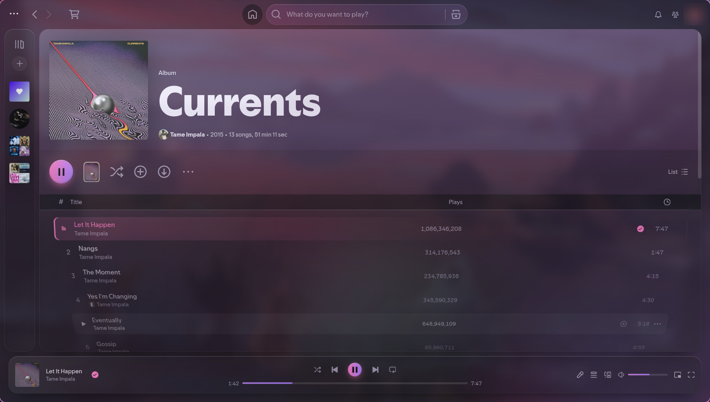
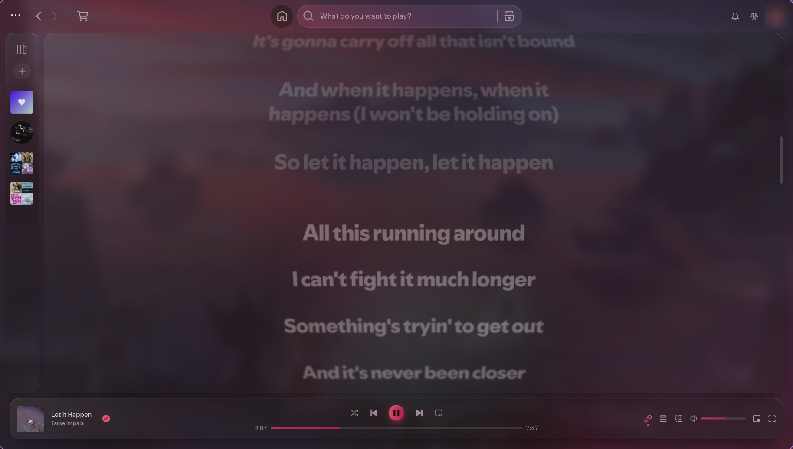
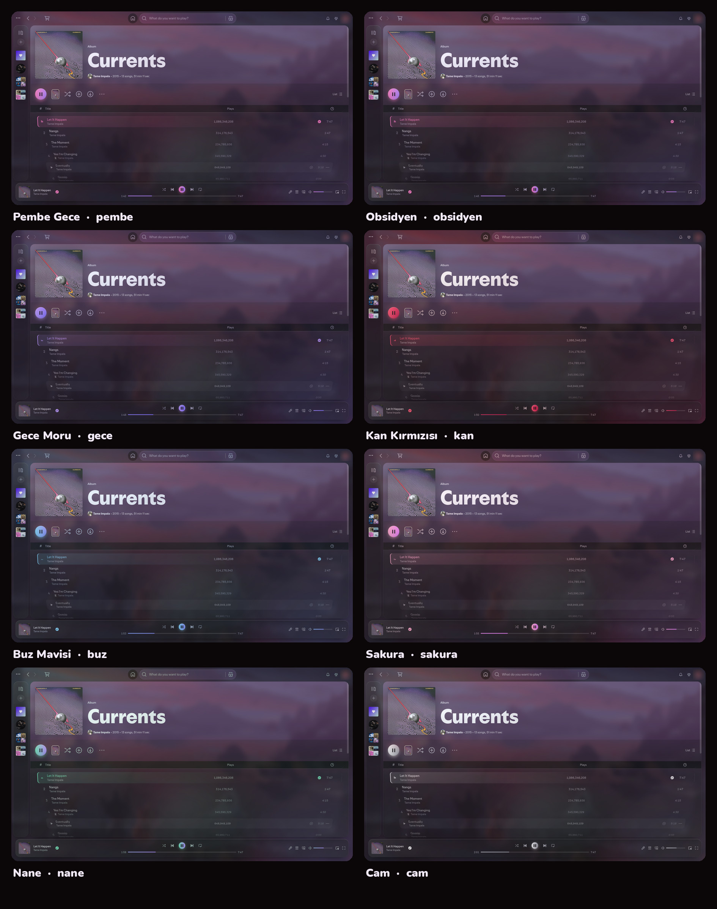

<div align="center">

# ฅ^•ﻌ•^ฅ Felinora for Spotify

**A dark liquid-glass [Spicetify](https://spicetify.app) theme.**

*Koyu, buzlu cam görünümlü bir Spicetify teması. Türkçe açıklama aşağıda.*

</div>

---



## ✨ Features

- **Liquid glass:** the playing song's cover, blurred, sits behind everything; panels are frosted glass on top of it and it crossfades when the song changes.
- **Rolling track list:** rows tilt and fade towards the edges as you scroll (pure CSS, so scrolling stays smooth). A clicked song glides to the middle.
- **Glowing lyrics:** big centered lines, the current line painted with the theme gradient.
- Floating rounded panels, pill track rows, floating player bar, gradient progress bar.
- **8 color schemes** (below).



## 🎨 Color schemes

`pembe` (default) · `obsidyen` · `gece` · `kan` · `buz` · `sakura` · `nane` · `cam`



## 🚀 Installation

### Marketplace

Open **Marketplace → Themes**, search for **Felinora** and click Install. Pick a color scheme in the Marketplace settings.

### Manual

```sh
git clone https://github.com/realFelinora/felinora-spicetify
cp -r felinora-spicetify/Felinora "$(dirname "$(spicetify -c)")/Themes/"

spicetify config current_theme Felinora color_scheme pembe inject_theme_js 1
spicetify apply
```

On Windows, copy the `Felinora` folder to `%APPDATA%\spicetify\Themes\` and run the same `spicetify config` / `apply` commands in PowerShell.

Change the scheme any time: `spicetify config color_scheme kan && spicetify apply`

### Tips

- For a softer, momentum-like scroll, start Spotify with `--enable-smooth-scrolling --enable-features=ImpulseScrollAnimations`.
- Tested with Spotify **1.3.8** and Spicetify **2.46**. Spotify changes its class names now and then; if something looks broken after a Spotify update, please open an issue.

---

## 🇹🇷 Türkçe

Çalan şarkının bulanık kapağı arkada durur, paneller onun üstünde buzlu cam gibi görünür. Şarkı listesi kaydırırken çark gibi eğilir, şarkı sözlerinde çalan satır temanın renkleriyle parlar.

**Kurulum:** Spicetify Marketplace'te **Themes** sekmesinde "Felinora"yı arayıp kur. Ya da yukarıdaki komutlarla elle kur.

**Renk şemaları:** `pembe` (varsayılan), `obsidyen`, `gece`, `kan`, `buz`, `sakura`, `nane`, `cam`. Değiştirmek için: `spicetify config color_scheme kan && spicetify apply`

## 🐾 Also

The same color palettes are used by my Hyprland desktop: **[realFelinora/dots](https://github.com/realFelinora/dots)**

## Credits

Made by **[realFelinora](https://github.com/realFelinora)**, written with the help of the AI assistant **Claude** (Anthropic).

## License

[GPL-3.0-or-later](LICENSE)
